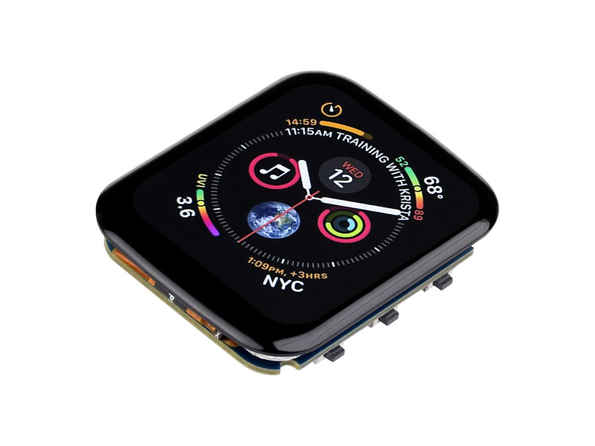

  <h1>ESP32-S3-Touch-LCD-1.69</h1>
  
<strong>ESP32-S3 1.69-inch 240 x 280 SPI LCD touch development board</strong>

  

    
    
    
  

  
<strong>English</strong> | <a href="README_ZH.md">简体中文</a>

  

    <a href="https://www.waveshare.com/esp32-s3-touch-lcd-1.69.htm">🌐 Product</a> &middot;
    <a href="https://github.com/waveshareteam/ESP32-S3-Touch-LCD-1.69/releases/latest">📦 Firmware</a> &middot;
    <a href="examples/esp-idf/">🧩 ESP-IDF</a> &middot;
    <a href="examples/arduino/examples/">🔧 Arduino</a> &middot;
    <a href="hardware/">📚 Documentation</a>
  

  

---

## ✨ Overview

This repository provides ESP-IDF and Arduino examples, firmware downloads and hardware resources for the Waveshare ESP32-S3-Touch-LCD-1.69. The board combines an LCD, capacitive touch, a six-axis IMU, a real-time clock and lithium battery management for wearable devices and interactive control panels.

| Feature | Device / interface |
| --- | --- |
| MCU | ESP32-S3R8, dual-core Xtensa LX7 at 240 MHz |
| Memory | 16 MB Flash and 8 MB PSRAM |
| Wireless | 2.4 GHz Wi-Fi and Bluetooth 5 LE |
| Display | 1.69-inch 240 x 280 SPI LCD using ST7789V2 |
| Touch | CST816T capacitive touch controller over I2C |
| Motion sensor | QMI8658C six-axis IMU over I2C |
| Real-time clock | PCF85063ATL over I2C |
| Power | ETA6098 single-cell lithium battery charge/discharge management and battery voltage sampling |
| User interfaces | Onboard buzzer, USB Type-C, and BOOT / power buttons |
| Expansion | 5 V, 3.3 V, GND, I2C, UART, and GPIO signals |
| Board support | Available managed BSP: [`waveshare/esp32_s3_touch_lcd_1_69`](https://github.com/waveshareteam/Waveshare-ESP32-components/tree/master/bsp/esp32_s3_touch_lcd_1_69) |

## 📦 Quick Start

Download a ready-to-flash package for your example and framework version from the [latest release](https://github.com/waveshareteam/ESP32-S3-Touch-LCD-1.69/releases/latest).

1. Download the example firmware ZIP package.
2. Extract it and install esptool with `python -m pip install esptool`.
3. Connect the board over USB.
4. Run the flashing script described in the package README.
5. Reset the board if it does not restart automatically.

Factory firmware (restores the out-of-box demo): download the file whose name contains `FactoryOnly` from the [`firmware`](firmware/) folder.

## 🧪 Examples

### ESP-IDF

| Example | Focus |
| --- | --- |
| [01_ESP_IDF_ST7789](examples/esp-idf/01_ESP_IDF_ST7789/) | ST7789V2 LCD bring-up |
| [02_ESP_IDF_ST7789_LVGL](examples/esp-idf/02_ESP_IDF_ST7789_LVGL/) | LVGL display and CST816T touch integration |
| [03_PCF85063](examples/esp-idf/03_PCF85063/) | PCF85063 real-time clock |
| [04_QMI8658](examples/esp-idf/04_QMI8658/) | QMI8658 six-axis IMU |

### Arduino

| Example | Focus |
| --- | --- |
| [01_HelloWorld](examples/arduino/examples/01_HelloWorld/) | Arduino GFX display bring-up |
| [02_Drawing_board](examples/arduino/examples/02_Drawing_board/) | Capacitive-touch drawing board |
| [03_GFX_AsciiTable](examples/arduino/examples/03_GFX_AsciiTable/) | GFX text and character rendering |
| [04_GFX_ESPWiFiAnalyzer](examples/arduino/examples/04_GFX_ESPWiFiAnalyzer/) | Wi-Fi scanning and channel visualization |
| [05_GFX_Clock](examples/arduino/examples/05_GFX_Clock/) | Graphical clock rendering |
| [06_GFX_PCF85063_simpleTime](examples/arduino/examples/06_GFX_PCF85063_simpleTime/) | PCF85063 RTC with GFX output |
| [07_LVGL_Measuring_voltage](examples/arduino/examples/07_LVGL_Measuring_voltage/) | LVGL battery-voltage monitor |
| [08_LVGL_PCF85063_simpleTime](examples/arduino/examples/08_LVGL_PCF85063_simpleTime/) | PCF85063 RTC with an LVGL interface |
| [09_LVGL_Keys_Bee](examples/arduino/examples/09_LVGL_Keys_Bee/) | Button gestures and buzzer feedback |
| [10_LVGL_QMI8658_ui](examples/arduino/examples/10_LVGL_QMI8658_ui/) | LVGL IMU data visualization |
| [11_LVGL_Arduino](examples/arduino/examples/11_LVGL_Arduino/) | LVGL widgets with display and touch input |

Sketch libraries are bundled in [`examples/arduino/libraries/`](examples/arduino/libraries/).

## 🛠️ Development Environment

| Framework | Version | Examples |
| --- | --- | ---: |
| ESP-IDF | `v5.5.5` | 4 |
| ESP-IDF | `v6.0.2` | 4 |
| Arduino-ESP32 | `3.3.11` | 11 |

## 📚 Resources

- [Schematics](hardware/schematic/)
- [Mechanical dimensions](hardware/mechanical/)
- [Pinout](docs/images/ESP32-S3-Touch-LCD-1.69-Pinout.webp)
- [Product page](https://www.waveshare.com/esp32-s3-touch-lcd-1.69.htm)
- [Wiki](https://docs.waveshare.com/ESP32-S3-Touch-LCD-1.69)

## 🤝 Support

- Example or repository problems: [open an issue](https://github.com/waveshareteam/ESP32-S3-Touch-LCD-1.69/issues).
- Product usage, hardware or order questions: [Waveshare support](https://service.waveshare.com/).

## 📄 License

Apache License 2.0. See [LICENSE](LICENSE).
