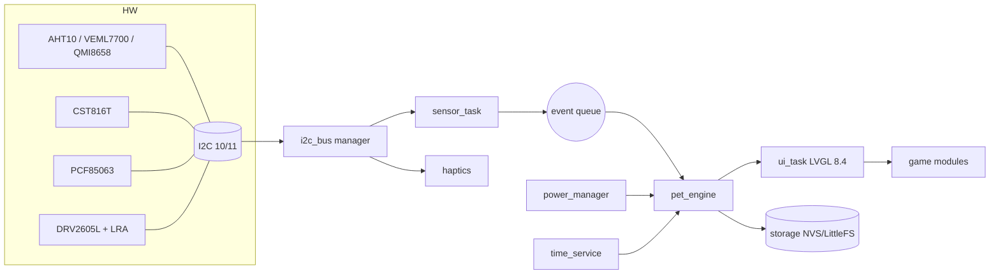

# Pocket Pet – Research & Design (ESP32-S3-Touch-LCD-1.69)

Status: draft v0.1 (research + design only, no firmware yet).
Sources: `hardware/schematic/*.pdf` (V1 and **V2.1**), `examples/`, README, ETA6098 datasheet (ETA Semi V1.1).
Items marked **[verify]** are inferred from the schematic and must be bench-tested.

---

## 1. Hardware & software baseline

### 1.1 Onboard components

| Function | Part | Bus / pins (V2.1) | Notes |
| --- | --- | --- | --- |
| MCU | ESP32-S3R8 (dual LX7, 8 MB octal PSRAM), 16 MB flash (W25Q128) | – | GPIO33–37 are used by octal PSRAM; don't use them |
| Display | ST7789V2, 240×280 | SPI2: DC=4, CS=5, SCK=6, MOSI=7, RST=8; BL=15 (via MOSFET Q3) | Arduino GFX uses panel offsets (0,20,0,20) |
| Touch | CST816T | I²C 0x15; SDA=11, SCL=10, RST=13, INT=14 | INT is an RTC-capable GPIO (can wake from sleep) |
| IMU | QMI8658C 6-axis | I²C **0x6B**; INT1=GPIO38 (INT2 not routed to a free GPIO) | Wake-on-motion possible |
| RTC | PCF85063ATL | I²C 0x51; INT=GPIO39 | Has a 32.768 kHz crystal; separate `BAT1` backup-cell connector |
| Charger | **ETA6098** (not an AXP2101) | VIN=VBUS, output straight to battery (`B+`); STAT pin **not** wired to the MCU | `XPOWERS_CHIP_AXP2101` in `board_config/pin_config.h` is a leftover; there is no PMIC with I²C |
| Battery sense | 200 k / 100 k divider on `B+` | ADC1 = **GPIO1** (Vbat = Vadc × 3) | Constant ~14 µA draw |
| Power latch | Q5 (AO3401 P-FET) + T2 + Key2 | SYS_EN = **GPIO41** (out), SYS_OUT = **GPIO40** (in, reads power key) | See §2 |
| Buzzer | Transistor-driven buzzer | **GPIO42** (V2.1; GPIO33 on V1) | Confirm active vs passive [verify] |
| Buttons | BOOT (GPIO0), RESET (CHIP_PU), power key (Key2) | | |
| 3.3 V rail | ME6217C33 LDO from `VBAT` | | **Buck-only: no boost**, so useful Vbat ≥ ~3.6 V |
| I/O expander | **none** | | Everything is direct GPIO |
| SHTC3 | footprint listed in the pin table, not populated | | Free I²C address 0x70, no conflict |

**Board revision: V2.1 (confirmed by the user).** Use buzzer GPIO42, SYS_EN GPIO41, SYS_OUT GPIO40, RTC_INT GPIO39 (example 09: `USE_NEW_PIN_CONFIG 1`). V1 differences are only in the appendix (§9).

### 1.2 Libraries, frameworks and versions used by the examples

| Item | Used by | Version |
| --- | --- | --- |
| ESP-IDF | `examples/esp-idf/*` | CI matrix **5.5.5** and **6.0.2** (README) |
| Arduino-ESP32 | `examples/arduino/*` | **3.3.11** |
| LVGL | IDF 02 (`lvgl/lvgl ^8.4.0` component), Arduino (bundled) | **8.4.0** (LVGL 8 API, not 9) |
| LVGL port | IDF 02 | `espressif/esp_lvgl_port ^2.3.3` |
| Touch driver | IDF 02 | `espressif/esp_lcd_touch_cst816s 1.0.3` |
| Display driver | IDF 01 / 02 | `esp_lcd` ST7789 panel (01 vendors `components/st7789`) |
| IMU / RTC (IDF) | 03, 04 | 03: raw I²C on legacy `driver/i2c.h`; 04: vendored **SensorLib** (`SensorQMI8658`) |
| Arduino | libs in `examples/arduino/libraries/` | GFX Library for Arduino **1.6.5**, Arduino_DriveBus **1.0.1** (CST816x), SensorLib **0.4.1** (QMI8658, PCF85063), lvgl 8.4.0, `lv_conf.h` |

IDF 02 `sdkconfig.defaults`: ESP32-S3, 16 MB QIO flash, **octal PSRAM @80 MHz**, LVGL 16-bit colour with byte swap, `LV_MEM_CUSTOM`.
Note: the I²C code in IDF 02 uses the legacy driver for IDF 5.x and `i2c_master` for 6.x. Legacy and new drivers cannot be mixed on one port, so pick one (use `i2c_master`).

### 1.3 Recommended starting point

**Decision (user): Arduino IDE with Arduino-ESP32 3.3.11.** Base the project on Arduino examples **11_LVGL_Arduino** (display + touch + LVGL) with **08** (PCF85063) and **10** (QMI8658) for the RTC/IMU code.

Arduino IDE setup (from the example READMEs and `.github/product.json`):
* Install the **esp32 core 3.3.11**; set **Sketchbook location = `examples/arduino/`** (or copy `examples/arduino/libraries/*` into your sketchbook `libraries/`) so the bundled, pinned libs are used: GFX Library for Arduino 1.6.5, Arduino_DriveBus 1.0.1, SensorLib 0.4.1, lvgl 8.4.0, plus `board_config/pin_config.h` and `lv_conf.h`. Don't install a second LVGL (v9 is not API-compatible).
* Board: **ESP32S3 Dev Module**, **Flash Size 16MB (128Mb)**, **PSRAM: OPI PSRAM** (FQBN `esp32:esp32:esp32s3:FlashSize=16M,PSRAM=opi`). Pick a 16 MB partition scheme (e.g. "16M Flash (3MB APP/9.9MB FATFS)") for assets and saves. Upload via the native USB port (see §10 for CDC settings).
* **Plain-IDE setup:** if you don't use the repo as sketchbook, install **GFX Library for Arduino 1.6.5** from Library Manager (Arduino_DriveBus/SensorLib 0.4.1 likewise, or copy the folders from `examples/arduino/libraries/` into `~/Documents/Arduino/libraries/`) and copy `board_config/pin_config.h` next to your sketch. `pocket-pet/tools/board_revision_test/` is set up this way (verified on a clean library install).
* Extra libraries from Library Manager: **Adafruit AHTX0** (supports AHT10), **Adafruit DRV2605**, **Adafruit VEML7700** (or small own drivers if you want the lowest RAM/power). They all use `Wire`, so they share the single `Wire.begin(11, 10)` bus with SensorLib/Arduino_DriveBus (`Arduino_HWIIC(IIC_SDA, IIC_SCL, &Wire)`). Guard every `Wire` access with one FreeRTOS mutex.
* Sleep/power APIs are still available in Arduino-ESP32: `esp_sleep_enable_*`, `esp_light_sleep_start()`, `esp_deep_sleep_start()`, `RTC_DATA_ATTR`, `Preferences` (NVS), `LittleFS`/`FFat`, `gpio_hold_en()`, `esp_pm_configure()` (DFS) may need a core built with PM support, so test tickless/light-sleep behaviour **[verify]**.
* Caveat: Arduino-ESP32 uses the IDF legacy I²C driver in Wire; just don't mix in `driver/i2c_master` calls on the same port.

(The ESP-IDF alternative, 02_ESP_IDF_ST7789_LVGL with `i2c_master`, gives finer power control and remains the fallback if Arduino sleep current turns out too high.)

### 1.4 I²C bus, address conflicts and free pins

One shared bus: **SDA=GPIO11, SCL=GPIO10**, 2.2 kΩ pull-ups on board (R1/R2) → use 400 kHz max, single `i2c_master_bus` with a device handle per chip.

| Device | Address | Conflict? |
| --- | --- | --- |
| CST816T | 0x15 | – |
| QMI8658C | 0x6B | – |
| PCF85063 | 0x51 | – |
| **AHT10** | 0x38 | none (AHT10 has a fixed address) |
| **DRV2605L** | 0x5A | none |
| **VEML7700** | 0x10 | none |

No conflicts. Cautions: CST816T may NAK while in auto-sleep (touch driver owns its own retries); keep sensor wiring short (extra capacitance on a 2.2 k bus); do not power-cycle sensor rail while touch is active.

Header / test-point pins available (from V2.1 schematic): `VBUS, GND, 3V3, U0RX/TX (GPIO44/43), SCL(10), SDA(11), GPIO2, GPIO3, GPIO17, GPIO18`.
Suggested use of the free ones: **GPIO2** = DRV2605L EN (hardware power-down in sleep), **GPIO3** = VEML7700 INT (ambient-light threshold wake), **GPIO17** = AHT10/aux power-gate or spare, **GPIO18** = spare (or DRV2605L IN/TRIG).
Powering sensors from 3V3 is fine (AHT10 2.0–3.6 V, DRV2605L 2–5.2 V, VEML7700 2.5–3.6 V). Optionally power-gate the sensor rail from a GPIO (≤ 20 mA GPIO source) to reach the lowest sleep current.

Sensor placement: AHT10 reads high near the charger/ESP32/display. Mount it at the shell edge with an air path, thermally isolated, and add a software offset plus "charging/screen-on" compensation. VEML7700 needs a light pipe/window; keep it away from the backlight leakage.

---

## 2. Power: auto-on, charging, safety

### 2.1 Power-on behaviour (from the V2.1 schematic)

* **USB present → the system powers up with no button.** VBUS feeds the 3.3 V LDO through diode D4. Q4 (P-FET, gate on VBUS) disconnects the battery path while VBUS is present. So plugging in USB always boots the ESP32 (Waveshare-style "power from USB" behaviour).
* **Battery only → needs the latch.** The battery (`B+`) is connected to the system rail `VBAT` through Q5, which is held on by T2 when **GPIO41 (SYS_EN) is high**, or momentarily by Key2. This is a soft-latch power switch.
* Therefore firmware **must drive GPIO41 high immediately at boot** (before display/LVGL init) so unplugging USB doesn't cut power. Hold it through sleep: `gpio_hold_en(41)` + `gpio_deep_sleep_hold_en()` (GPIO41 is not an RTC GPIO, so hold behaviour in deep sleep must be tested **[verify]**).
* Cold start from battery alone is only possible with Key2. If the key isn't reachable, the only boot sources are USB and (hardware mod) bridging Key2's pads or fitting a small external switch/reed contact across them. Bridging gives "battery always connected" (no off state; acceptable for a pet and fully consistent with §3 using sleep instead of power-off).
* **Pitfall:** any chip reset on battery power (watchdog, `esp_restart()`, brownout) releases GPIO41 → T2 off → Q5 off → power lost, and the pet goes "off" until USB is attached. Mitigations: keep reset paths minimal, test whether pad hold survives `esp_restart()` **[verify]**, or bridge Key2.
* Because of the latch, "power off" from software = `GPIO41 low` (only when on battery). Use it only for the deliberate critical-battery shutdown.

### 2.2 RTC while the device is "off" – the user's assumption is wrong

The PCF85063 VDD comes from `VCC3V3` (through D5) or from the separate `BAT1` backup connector. When the latch is off and USB is absent, `VCC3V3` is dead, so **the main battery does not keep the RTC running while the device is powered off**. It only runs while the system is on (including light/deep sleep).
Consequences/design:
* Never use soft power-off as "standby"; use deep sleep (RTC keeps running).
* Detect lost time via the PCF85063 oscillator-stop (OS) flag at boot; if set, run the "time lost" path (§3.3).
* Optional: add a tiny coin/supercap to `BAT1` (PH1.25 connector) so time survives a fully-drained battery.

### 2.3 Charging – how it works and the 2 A assumption

* Charger: **ETA6098** (buck charger, 4.2 V Li-ion, pre-charge / CC / CV / termination / auto-recharge, input OVP 32 V). Charge current is **set by a resistor on ISET, not by firmware**. Schematic table: 160 k → 1 A, **82 k → 2 A**, 66 k → 2.5 A. Populated: **R25 = 82 kΩ → 2 A fast-charge current** (confirmed by the datasheet: "2 A by 82 kΩ").
* The "2 A from the ESP32" claim is therefore **partly right**: the board charges at up to 2 A, but it is the ETA6098 (not the ESP32) and it can only be changed by swapping R25. There is no STAT-to-GPIO link, no I²C control, and no fuel gauge. You cannot read charge state directly; infer it from `BAT_ADC` trend and from USB-present detection (USB-Serial-JTAG VBUS/SOF state).
* USB-C CC pins have fixed 5.1 kΩ pull-downs, so the board is a plain sink: the achievable current depends on the source (500 mA – 3 A). 2 A is only reached on a ≥2 A source; with a weaker source the charger/input collapses or limits (watch for brownouts on weak ports).

**Safety findings / recommended settings**
1. 2 A on a 2500 mAh cell = **0.8 C**. This is within a "1C charge" cell spec, but only if the cell's own datasheet allows ≥0.8 C **standard charge**. Many cells list 0.5 C standard (1.25 A) with 1 C as a max. It is also hot in a sealed pocket device. **Recommendation:** change R25 to **160 kΩ (1 A, 0.4 C)** unless you need fast charge; this also lowers heat and wear.
2. **No NTC/temperature cut-off** is visible on the charger (no TS pin wiring). Charging in a warm pocket or enclosure has no hardware protection. Firmware should stop relying on that: use the AHT10 plus BAT_ADC to warn/limit use, and use a cell **with a built-in protection board (PCM)**.
3. **No battery under-voltage cut-off on the board.** The LDO simply runs until brownout. Use a protected cell, and have firmware shut down (or enter the lowest-power "dead pet sleeps" state) below ~3.45 V under load.
4. The 3.3 V comes from an LDO off the battery; below ~3.6 V the rail sags, so the usable capacity is less than 2500 mAh at the low end and radio/vibration peaks cause brownouts when the cell is low. Add bulk capacitance near the DRV2605L; LRA startup/overdrive peaks (hundreds of mA) can trip brownout near end of charge-state.
5. Battery connector is **PH1.25 with polarity per the board silk** – verify the polarity of your cell's connector before plugging in (the common reversed-polarity JST failure kills the board).
6. The charger stays connected while the pet runs from USB (D4/Q4 path); heat budget: do not keep the screen at full brightness while fast charging.
7. Battery percentage: derive from open-circuit voltage curve with a filtered, load-compensated reading; charging voltage reads high, so display "charging" and not %, when USB is present.

---

## 3. Firmware architecture

### 3.1 Overview



Arduino sketch layout (one folder, multiple `.h/.cpp` tabs next to the `.ino`): `board` (pins, latch, backlight), `i2c_bus` (Wire + mutex), `drv_*` wrappers (aht10, veml7700, drv2605, pcf85063, qmi8658), `time_service`, `sensors`, `pet_engine` (pure C++, no Arduino/IDF dependencies so it can be unit-tested on the host), `games/`, `ui`, `haptics`, `settings` (Preferences), `storage` (LittleFS), `power_mgr`. Keep `setup()`/`loop()` thin: `loop()` runs `lv_timer_handler()` on core 1; other work runs in `xTaskCreatePinnedToCore` tasks.

Tasks: `loop`/ui (LVGL, core 1), `sim`/`pet` (event-driven, 1 Hz when awake), `sensor` (periodic), `power` (state machine). One I²C mutex/bus; sensor and touch reads are short. Communication via FreeRTOS queues (no shared mutable state across tasks).

### 3.2 Pet state model

* **Vitals (0–100):** Satiety, Mood (happy↔depressed), Energy, Hygiene (optional), **Life** (HP).
* **Traits (permanent, 0–100 each, grow with training and age):** see §4.
* **Meta:** age, life stage (egg → baby → child → teen → adult → elder), personality seed, coins/items, game stats, last-seen epoch, flags (sleeping, sick, dead).
* **Evaluation:** "lazy simulation". `pet_step(state, dt, env)` is called on every wake with `dt = now_epoch - last_epoch`, split into 5-minute steps (cap catch-up to e.g. 24 h and apply a 50% slowdown while the pet is asleep or the device was off) so a missed hour doesn't kill the pet. Pure deterministic function of (state, dt, env, RNG seed) → host-testable.
* Starvation: Satiety = 0 → Life drains. Neglect: Mood < 25 (depressed) multiplies Life drain ×1.5. Death needs Life = 0 → egg/legacy trait inheritance (soft reset).
* Care actions: feed (food types give different Satiety/Mood/trait XP), play (games), clean, comfort (stroke on screen + haptic purr), medicine when sick, lights on/off (and sleep schedule).

### 3.3 Time / RTC handling (no backup battery)

* PCF85063 holds **UTC epoch + OS flag**; at boot read it, set the system clock (`settimeofday`), then use the ESP timer between reads. Re-read the RTC at each wake (internal RC clock drifts in sleep; the 32 kHz crystal on the board is the reference). GPIO15/16 are used by the backlight and unrouted, so the ESP32's own 32 kHz crystal is not available.
* Because the RTC dies when the latch is off (§2.2), at boot:
  1. OS flag clear and RTC time ≥ saved `last_epoch` → normal catch-up.
  2. OS flag set / time lost / time went backwards → show "set time" prompt (or optional one-off Wi-Fi NTP sync), treat the gap as a "dormant" (a capped small penalty).
* Keep `last_epoch` in the save file, written at each step. Local time/timezone offset is stored in settings (UTC in RTC).
* RTC alarm/timer (INT=GPIO39) can wake from **light sleep** (GPIO39 is not an RTC GPIO, so not for deep sleep); deep sleep wakes use the ESP RTC timer plus touch (GPIO14).

### 3.4 Sensors and settings toggles

* `sensor_task` samples on a configurable period; each sensor has a **Settings → Sensors** toggle (Temperature/Humidity, Light, Motion) and interval choices (1 / 5 / 15 / 60 min active; slower multiples in sleep). Disabled sensor → driver put into shutdown and not polled; pet treats missing input as neutral.
* AHT10: trigger measurement, wait ~80 ms, read, median-of-3, EMA smoothing; log hourly min/max ring buffer for stats. VEML7700: power-save mode, auto gain/integration; lux on a log scale. QMI8658: wake-on-motion (INT1=GPIO38) for "picked up" events; accelerometer only when playing games.
* Hysteresis and a minimum dwell time (e.g. 10 min) before an environmental state changes, so effects don't flicker.

### 3.5 Sleep strategy

| State | Screen | CPU | Wake | Use |
| --- | --- | --- | --- | --- |
| Active | on | DFS 80–240 MHz | – | Interaction |
| Dim/idle (≈15 s) | 10 % BL, LVGL slow | 80 MHz | touch | Short idle |
| **Light sleep** (≈1 min after idle) | off (BL off, ST7789 sleep) | `esp_light_sleep_start`, RAM and PSRAM retained | touch INT (GPIO14), IMU motion (38), RTC alarm (39), timer | Frequent short wakes, instant resume |
| **Deep sleep** (after ≈10 min, user-selectable) | off | state in `RTC_DATA_ATTR` + NVS | touch (ext0/GPIO14), timer (slow poll) | Lowest drain, wake poll cycle |

Wake poll cycle (timer wake, e.g. every 15–60 min): init I²C → read enabled sensors → `pet_step` → persist if state changed materially → decide to **light the screen/haptic alert** (e.g. hungry, extreme temperature) or go straight back to sleep (<300 ms awake target). Before sleeping: GPIO41 hold high, backlight off + hold, ST7789 sleep-in, touch to gesture-wake mode, DRV2605L standby (EN low via GPIO2), sensors in shutdown/low-power, disable Wi-Fi/BT (never started).
Power budget: to be measured; the board's baseline (LDO Iq, 14 µA battery divider, IMU/touch/RTC standby, PSRAM) is expected in the sub-mA to ~1 mA range in sleep, so days–weeks on 2500 mAh are plausible **[verify with a µA-meter]**.
Low battery: below ~3.55 V reduce poll rate and screen brightness; below ~3.45 V warn and, when on battery, save and power down via GPIO41 low.

### 3.6 Haptics (DRV2605L + 8×3.2 mm LRA)

* Set LRA mode (N_ERM_LRA=1), library 6 (LRA), closed-loop; run the **auto-calibration** once (needs motor rated voltage and resonant frequency from the motor datasheet – confirm), store the calibration regs in NVS, restore on boot. Verify the motor's rated voltage vs the DRV2605L VDD (3.3 V) setting.
* Use the waveform sequencer (8 slots) to compose a haptic vocabulary: `HEARTBEAT` (idle bond pulse), `PURR` (petting, soft continuous), `HUNGRY` (3 short), `ALERT` (strong double), `HAPPY` (rising ramp), `CRY/ SAD` (falling ramp), `GAME_*` (tick/hit/miss/win), plus a settings "intensity" scalar (RTP amplitude).
* EN pin on a GPIO to hard power down; I²C access guarded by the bus mutex; never block the UI while playing (queue + short effects).

### 3.6b Sound – the buzzer is the pet's voice

**Requirement (user):** the onboard buzzer is used for the pet to send emotes and other noises: mood sounds, chirps, game effects and event alerts.

* **Hardware:** buzzer driven by an SS8050 NPN through R14 (1 kΩ) with a flyback diode. Pin = `BUZZER_PIN`: **GPIO42 on V2.1, GPIO33 on V1** (§9). The schematic does not show whether it is active or passive; the driver circuit is compatible with either. Treat it as **passive** (as assumed) but bench-test: if a constant 3.3 V level makes it sound, it is active and only on/off beeps are possible (then pitch-based melodies won't work). **[verify]**
* **Driving under Arduino-ESP32 3.x:** `ledcAttach(BUZZER_PIN, 2000, 8)` then `ledcWriteTone(BUZZER_PIN, freq)` to play, `ledcWriteTone(pin, 0)` to stop. Volume: passive buzzers are loudest at their resonance (~2–4 kHz **[verify]**) and duty cycle is the only volume control, so use `ledcWrite(pin, duty)` with duty 0–50 % mapped to the volume setting (e.g. 4 levels). Play from a small `sound` task with a queue of notes (freq, ms) so the UI never blocks.
* **Boot/sleep:** drive the pin LOW (`ledcDetach` + `pinMode(OUTPUT)` + `digitalWrite(LOW)`) at the start of `setup()` and before every sleep (and `gpio_hold_en` for deep sleep) so the transistor stays off and there is no leakage or stuck tone.
* **Settings:** Sound on/off (mute), volume (4 steps), "alerts only" mode, **quiet hours** (e.g. 22:00–07:00 by RTC local time: sounds muted, haptics-only alerts; the pet's sleeping state also mutes). Sleep wake-ups for sensor polls are silent unless a critical alert (near death) is raised, and critical alerts respect mute unless "critical override" is enabled.
* **Coordination with haptics:** an event is a `Cue{sound, haptic}` pair played together from one `cue_player`. Sounds and LRA run in parallel but the buzzer is mutually exclusive between cues (priority queue: critical > care alert > pet emote > game > UI). Haptics-only when muted; sound-only when haptics are off. Avoid long continuous buzzer tones while the LRA is overdriving (peak current on the LDO).

| Category | Cue | Sound | Paired haptic |
| --- | --- | --- | --- |
| Mood | Happy | rising 3-note chirp | HAPPY ramp |
| Mood | Content/idle | soft single blip every few min (optional) | HEARTBEAT |
| Mood | Sad/depressed | slow falling 2 notes | SAD ramp |
| Mood | Sleepy | slow descending yawn glide | none |
| Mood | Angry/grumpy | low rapid buzz stutter | strong double |
| Care | Hungry | 3 short chirps, repeating with back-off | HUNGRY |
| Care | Eating | "nom" rapid ticks | PURR |
| Care | Petting | soft purr (low pulsed tone) | PURR |
| Care | Sick | wobbling tone | ALERT |
| Env | Cold | shivering trill | soft tick pulses |
| Env | Hot | panting short puffs | none |
| Env | Dark/bright | gasp / "ooh" sweep | none |
| Life | Low life (<25) | urgent double beep | ALERT |
| Life | Death / evolve | sad melody / fanfare | long fade / celebration |
| Game | Tick/hit/miss/win/lose | short blips, win jingle, lose descend | GAME_* |
| UI | Tap, back, error, save | tiny click, chirp, buzz | light tick |

**Trait/personality mapping:** each pet gets a base pitch and a "voice" derived from its personality seed and dominant trait, so pets sound distinct: STR = low, AGI = fast staccato, WIT = quirky arpeggios, MEM = repeated motifs, FOC = pure steady tones, RHY = rhythmic patterns, LCK = playful glissandi, STA = long relaxed tones, HRD = warm mid tones. Mood shifts pitch/tempo (happy = higher/faster). Sound data are `const` note arrays (freq, ms) in flash, a few hundred bytes in total.

### 3.6c Prototype status, pet rendering and external boards

**Hatching:** a new pet is an egg for `HATCH_SECONDS` (60 s). `Pet.hatchEpoch` (RTC) is persisted, stats do not simulate before it, and the egg sprite (32x32 source, 4x scaled) wobbles harder and gains cracks with progress, then breaks with a glow and a hatch emote/haptic.


* A first prototype lives in `pocket-pet/pocket_pet/` (see `pocket-pet/README.md`). It is plain GFX Library for Arduino 1.6.5 with an off-screen `Arduino_Canvas` (PSRAM), not LVGL; the LVGL plan in §3.7 stays the target for the full UI.
* **Pet art renders at 4× pixel count:** sprites are authored on a low-res palette grid (prototype: 32×32) and drawn nearest-neighbour with each source pixel as a 4×4 block, i.e. 128×128 on the 240×280 panel (a 48×48 source would give 192×192). Source sprites cost ~1 KB (1 byte/pixel palette indices, or 1–4 bpp when stored in flash), and are drawn as horizontal runs of `fillRect` into the canvas. Mood variants (eyes, mouth, colours) are composed at source resolution so the pixel grid stays crisp.
* **External boards (AHT10, VEML7700, DRV2605L) may be absent:** they are probed at boot (boot screen shows OK / not attached), re-probed every 10 s and on each sleep wake, and every consumer skips a missing board. The DRV2605L is set up and auto-calibrated the first time it appears; calibration is cached in NVS.

### 3.7 UI structure (LVGL 8.4, 240×280)

* **Home:** pet scene, vitals icons (small bars), environment overlay layer (temperature/humidity/light effects), time.
* Swipe left: **Care** (feed, clean, medicine, comfort, light). Swipe right: **Games** (grid, locked/unlocked, trait tags). Swipe up: **Status** (vitals, traits, age, achievements, charts of recent temp/light). Swipe down: **Quick settings** (brightness, haptics, sound, sleep now).
* **Settings:** sensors (toggles + intervals), sleep (timeouts, deep-sleep poll rate, night schedule), haptics/sound, display brightness (auto from light), time/timezone/set clock, units (°C/°F), temperature offset calibration, save backup/reset, about (battery voltage, board revision).
* Screen manager with one active screen; sprites/animations as RGB565 in flash/PSRAM; use partial 240×50 double draw buffers as in IDF 02; LVGL timer handler on a dedicated task, tickless friendly (stop LVGL timers in sleep).

### 3.8 Persistence

* **NVS:** settings, calibration (temp offset, haptics), boot count.
* **Pet save:** versioned binary struct + CRC in LittleFS (or two NVS blob slots, A/B) – written on significant changes, every ~15 min of active time, on game completion and before deep sleep (flash wear: ≤ a few hundred writes/day is fine). Migrations by `version` field.
* `RTC_DATA_ATTR`: last wake epoch, sensor history for the current sleep period, "dirty" flag.
* Partition table: factory app (~4–6 MB), NVS, `storage` LittleFS (~8 MB) for sprites/assets/saves; keep an OTA slot optional.

---

## 4. Pet characteristics (9)

| # | Trait | Meaning | Main influence |
| --- | --- | --- | --- |
| 1 | **Strength (STR)** | Power | Force/tap-power games, carrying items |
| 2 | **Agility (AGI)** | Speed & reflex | Dodge/runner games, reaction window |
| 3 | **Wit (WIT)** | Problem solving | Puzzle games (hints, time) |
| 4 | **Memory (MEM)** | Recall | Sequence length / reveal time |
| 5 | **Focus (FOC)** | Steadiness/precision | Steady-hand, timing (bigger target windows) |
| 6 | **Rhythm (RHY)** | Timing sense | Beat games, haptic-pattern games |
| 7 | **Luck (LCK)** | Fortune | Odds shifts in chance games, rare drops |
| 8 | **Stamina (STA)** | Endurance | Energy cost per round, endurance games, vitals decay rate |
| 9 | **Hardiness (HRD)** | Weather tolerance | Widens comfort temperature band, reduces cold/heat penalties |

Training: each game grants XP to its primary trait (and half to secondary) with diminishing returns per day; high Mood multiplies XP, depressed pets gain less. Traits slowly decay if never used (cap), so care matters. Stage-ups give bonuses and unlock games.

## 5. Mini-game catalog (40)

Inputs: T = touch, IMU = tilt/shake, L = light sensor, Temp = AHT10, H = haptic, B = buzzer. Each game scales difficulty by its trait and awards trait XP.

| # | Game | Primary / Secondary | Mechanic / input |
| --- | --- | --- | --- |
| 1 | Tug-o-Tap | STR / STA | Mash to win a tug-of-war vs a computer opponent (T) |
| 2 | Boulder Push | STR / FOC | Hold & shake the device to push a boulder up a hill (IMU) |
| 3 | Log Toss | STR / FOC | Swipe length = power, timing sets angle (T) |
| 4 | Arm Wrestle | STR / RHY | Tap in time to overpower the rival (T) |
| 5 | Hop Dash | AGI / STA | Endless runner, tap to jump (T) |
| 6 | Rain Dodge | AGI / FOC | Tilt to dodge falling objects (IMU) |
| 7 | Tail Chase | AGI / WIT | Swipe circles to catch the tail; speed ramps (T) |
| 8 | Wall Bounce | AGI / FOC | Single-paddle pong (T/IMU) |
| 9 | Ninja Slice | AGI / FOC | Swipe-slice items, avoid bombs (T) |
| 10 | Riddle Box | WIT / MEM | Choose the right icon for a riddle (T) |
| 11 | Slide Tiles | WIT / FOC | 3×3 sliding puzzle (T) |
| 12 | Tilt Maze | WIT / FOC | Roll the pet through a maze (IMU) |
| 13 | Odd One Out | WIT / AGI | Spot the different icon in a grid under time (T) |
| 14 | Snack Math | WIT / LCK | Combine numbers to hit a target (T) |
| 15 | Simon Says | MEM / RHY | Repeat growing colour/sound sequence (T, B, H) |
| 16 | Pair Flip | MEM / WIT | Card matching, grid grows by trait (T) |
| 17 | Treasure Spots | MEM / LCK | Remember where treats were hidden (T) |
| 18 | Echo Buzz | MEM / RHY | Memorise & replay haptic patterns (H, T) – can be played "blind" |
| 19 | Steady Hand | FOC / STA | Keep the device still while a bubble wobbles (IMU) |
| 20 | Bullseye | FOC / AGI | Stop a moving needle on the target (T) |
| 21 | Balloon Pump | FOC / STR | Hold press steady in a zone to inflate (T + H feedback) |
| 22 | Dot Trace | FOC / WIT | Trace a path with a finger without leaving it (T) |
| 23 | Firefly Catch | FOC / AGI | Tap fireflies at the right instant (T) |
| 24 | Beat Bounce | RHY / AGI | Tap on beat for a bouncing ball (T, B, H) |
| 25 | Drum Duet | RHY / MEM | Call-and-response drum patterns (T, B) |
| 26 | Tilt Disco | RHY / AGI | Tilt left/right on beat cues (IMU) |
| 27 | Heartbeat Sync | RHY / FOC | Match the haptic heartbeat with taps, eyes closed (H, T) |
| 28 | Lucky Spin | LCK / – | Wheel of rewards, trait biases the odds (T) |
| 29 | Shell Game | LCK / MEM | Track the hidden treat under moving cups (T) |
| 30 | Scratch Card | LCK / – | Scratch cells for prizes (T) |
| 31 | Gone Fishing | LCK / FOC | Wait for a bite (haptic nibble), reel at the right time (T, H) |
| 32 | Coin Tower | LCK / FOC | Stack coins; risk-or-cash-out (T) |
| 33 | Step Counter Trek | STA / HRD | Real steps with the device (IMU step detect) fill a trek bar; works while carried |
| 34 | Steady Climb | STA / RHY | Tap a steady tempo up a cliff without tiring (T) |
| 35 | Butter Churn | STA / STR | Shake continuously for a period (IMU) |
| 36 | Sun Chaser | HRD / LCK | Shine a light/phone torch on the sensor to grow a plant (L) |
| 37 | Cave Explorer | HRD / FOC | Cover the sensor to enter "dark cave" and collect crystals (L, H) |
| 38 | Warm Breath | HRD / STA | Breathe on/near the sensor to thaw an ice block (Temp rise) |
| 39 | Weather Watcher | HRD / WIT | Predict the next real temp/light trend from history, bets (Temp, L) |
| 40 | Hot Potato | AGI / LCK | Pass the "potato" by shaking before the timer ends (IMU, H) |

First release can target ~12 games and unlock the rest per life stage.

---

## 6. Environment effects and stat rules

### 6.1 Temperature (AHT10)
Comfort band: 18–26 °C; the band shifts ±(HRD/10) °C. Rates below are per hour awake; halve while asleep.

| Zone | Temp | Screen effect | Rules |
| --- | --- | --- | --- |
| Freezing | < 5 °C | Frost on screen edges, breath puffs, shiver anim | Energy −3, Mood −3, Life −2 (reduced by HRD); Satiety drain ×1.3 |
| Cold | 5–14 °C | Light snow, scarf sprite | Mood −1.5, Satiety ×1.15 |
| Cool | 14–18 °C | Blanket/cosy anim | Neutral (+1 Mood for a "cozy" action) |
| **Comfort** | 18–26 °C | Normal | **Mood +1, Energy regen +20 %** |
| Warm | 26–31 °C | Sweat drops, fan | Satiety ×1.2, Energy −1 |
| Hot | 31–36 °C | Heat shimmer, panting | Energy −3, Mood −2, Life −1 |
| Extreme | > 36 or sustained heat | Red vignette, alarm haptic | Life −3 (reduced by HRD); alert once per episode |

Humidity: >75 % → water drops/fog on glass, Hygiene −; <25 % → dry/cracked tint, Mood −0.5. Apply changes gradually with hysteresis; ignore the first 10 min after charging starts and during heavy screen use (self-heating), and use the calibration offset.

### 6.2 Light (VEML7700)
Dark (< ~5 lx) at night hours → pet sleeps, Energy regen ×2; waking it costs Mood. Dark during the day → "bored/lonely" (Mood −0.5/h). Bright (> ~1000 lx) → sun-glasses effect, Mood +, Energy +. Auto brightness derived from lux.

### 6.3 Base vitals (per hour awake; tunable constants)
* Satiety −4 (≈25 h from full to empty); Mood −3; Energy −3 (+10/h while asleep).
* Care: feed +25–40 Satiety (overfeeding → sick); play +10–20 Mood, −10–15 Energy; comfort/petting +5 Mood; sleeping: Energy +10/h.
* Life: regen +1/h when Satiety > 50 and Mood > 50; **drain −2/h if Satiety = 0**, **×1.5 if depressed (Mood < 25)**, additional drain from §6.1/6.2 and sickness; death at 0.
* Mercy rules: sleeping pet drains at 50 %; offline catch-up capped to 24 h; first death warning haptic/screen at Life < 25.
* Evolution depends on average care + dominant trait.

---

## 7. Verification of the earlier "Pocket Pal" notes

| Claim | Result |
| --- | --- |
| I²C SDA=GPIO11, SCL=GPIO10, shared | **Confirmed** (schematic, all examples). 2.2 kΩ pull-ups on board. |
| Addresses VEML7700 0x10, CST816T 0x15, AHT10 0x38, PCF85063 0x51, DRV2605L 0x5A, QMI8658C 0x6B | **Confirmed, no conflicts.** 0x15/0x51/0x6B are in repo code or schematic; the other three are from the parts' datasheets, not the repo. |
| Header exposes 3V3/GND/GPIO10/GPIO11 | **Confirmed per schematic** (test-point/pad list: VBUS, GND, 3V3, U0RXD/TXD, SCL(10), SDA(11), GPIO2/3/17/18). Check the physical pad layout in `docs/images/...Pinout.webp` before ordering the enclosure. |
| ETA6098, ~2.0 A fast charge | **Confirmed**: R25 = 82 kΩ → 2 A (schematic table, ETA6098 datasheet). 0.8 C is only OK if the cell allows it; 1 A (160 kΩ) is the safer choice (§2.3). Not firmware-adjustable. |
| LDO ME6217C33M5G, 800 mA | Part **confirmed** in schematic; 800 mA is the part's class rating (from datasheet knowledge, not the repo) **[verify]**. It is a pure LDO off the battery, so ≥ ~3.6 V is needed for a stable 3.3 V. |
| 5 V header pin is 0 V on battery | **Consistent**: that pin is `VBUS`, not a boost output. There is no boost converter, so it is 0 V without USB, and 5 V sensors can't be powered from the header on battery. |
| Wire.begin(11,10) once | Correct arg order (SDA, SCL) and matches examples 08/10. Call once, and in IDF create one `i2c_master` bus. |
| Drive buzzer pin LOW at boot | Sensible. The pin is **GPIO42 on V2.1** (GPIO33 on V1); drive it low (or LEDC off) before anything else to avoid a stuck tone. |
| ST7789 SLPIN (0x10) before sleep | Correct; use SLPOUT (0x11) + ~120 ms on wake, and also switch the backlight FET (GPIO15) off. |
| Keep SYS_EN/PWR_EN high in light sleep | **Exists: SYS_EN = GPIO41 (V2.1; GPIO35 on V1).** Required for battery operation (§2.1), and it is also what makes the device keep running after USB is removed. USB alone auto-powers the board, no latch needed while USB is present. Use pad hold in sleep. |
| Light sleep 17–40 days | **Implausibly optimistic vs. my estimate, or mixed**: 2500 mAh over 17–40 days is ~2.6–6 mA average, which is above my expected sleep floor (≲1 mA chip+board) but includes periodic wake cycles. Treat as a placeholder; measure with a µA meter. Practical usable capacity is ~85 % of rating because of LDO dropout cut-off. |
| Screen-on ≈26–33 h | Plausible: 2500 mAh / 26–33 h ≈ 76–96 mA average (backlight dominates). Reducing brightness, 80 MHz DFS and light sleep between frames will raise it. |
| LRA motor on DRV2605L | Covered in §3.6: set LRA mode, library 6, run auto-calibration, use rated voltage and resonant frequency (typ. 170–235 Hz) from the motor datasheet. Don't drive an LRA with ERM libraries. |
| 10–47 µF across VIN/GND on DRV2605L | Good practice (the DRV2605L needs ≥ 1 µF; add bulk for LRA overdrive peaks). All three modules sharing 3V3/I²C is fine electrically; the board's 3V3 pad is the shared source. |

---

## 8. Open questions

1. ~~Board revision?~~ **Closed: V2.1 confirmed.**
2. Do you accept swapping R25 (82 k → 160 k) for 1 A charging, and does your cell have a protection circuit (PCM) and a stated standard charge rate?
3. Can the power key be bridged or an external switch fitted, or must the device only start from USB? (affects §2.1)
4. Add a backup coin cell/supercap on `BAT1` so time survives full discharge?
5. ~~IDF or Arduino?~~ Decided: Arduino IDE. Is Wi-Fi/NTP allowed for time sync, or fully offline?
6. LRA datasheet: rated voltage and resonant frequency (for the DRV2605L calibration)? Buzzer: active or passive (bench test in §3.6b)?
7. Pet theme/art style, life-stage count, whether death is permanent, and which of the 40 games should ship first?
8. Is the 4-pin AHT10 breakout 3.3 V compatible with on-board pull-ups (several breakouts add their own)?

---

## 9. Appendix: identifying board revision (V1 vs V2.1)

> **Status: the user's board is confirmed V2.1.** This section is kept for reference; use the V2.1 pins everywhere and ignore the V1 column.

The repo has two schematics: `ESP32-S3-Touch-LCD-1.69.pdf` (V1) and `..._V2.1.pdf`. The only differences found are pins:

| Signal | V1 | V2.1 |
| --- | --- | --- |
| Buzzer | GPIO33 | **GPIO42** |
| SYS_EN (power latch, output) | GPIO35 | **GPIO41** |
| SYS_OUT (power key, input) | GPIO36 | **GPIO40** |
| RTC_INT | **GPIO41** | **GPIO39** |

I²C, LCD, touch, IMU, charger and battery ADC (GPIO1) are identical. V1 pins GPIO33/35/36 are octal-PSRAM pins on the ESP32-S3R8, which is why V2.1 moved them. Everything you need for the pet except these four signals works on both.

Steps, safest first:
1. **Look at the board/PCB**: silkscreen/etching on the back (revision tag, "V2.1", date code), order/invoice date, and the product page / wiki / order history for the version you bought. Compare the layout near the PH1.25 battery connector, buzzer and BOOT/RESET keys with the two PDF pages (zoom the PDF). If still unclear, ask Waveshare support with the order number.
2. **Functional test with the repo's own example**: flash **09_LVGL_Keys_Bee** with `USE_NEW_PIN_CONFIG 0` (V1 pins 36/35/33). If the power-key long-press and buzzer don't work, set it to `1` (V2.1 pins 40/41/42). The one that works is your revision. The sketch's own comment says exactly this.
3. **RTC interrupt probe (read-only pins, no output driving)**: the RTC_INT line moves between GPIO41 (V1) and GPIO39 (V2.1) so it identifies the revision without driving any pin that matters. Test on **USB power**, not on battery only.
   ```cpp
   #include <Wire.h>
   #include "SensorPCF85063.hpp"   // SensorLib 0.4.1, as in example 08
   SensorPCF85063 rtc;
   void setup() {
     Serial.begin(115200);
     Wire.begin(11, 10);
     pinMode(39, INPUT_PULLUP);
     pinMode(41, INPUT_PULLUP);   // never OUTPUT on either: it is SYS_EN on V2.1
     if (!rtc.begin(Wire, 11, 10)) { Serial.println("RTC not found"); return; }
     // Arm a ~2 s RTC timer/alarm with SensorLib's PCF85063 API (see example 08 and
     // SensorPCF85063.hpp) so INT goes low; the exact call is not verified here.
     delay(3000);
     Serial.printf("GPIO39=%d GPIO41=%d (INT is active low)\n", digitalRead(39), digitalRead(41));
   }
   void loop() {}
   ```
   If GPIO39 reads LOW after the timer fires → **V2.1**; if GPIO41 reads LOW → **V1**. (Adapt the timer call to SensorLib's PCF85063 API.) Never configure GPIO33/35/36 as outputs; they are PSRAM pins on the S3R8.
4. An **I²C scan** (0x15, 0x51, 0x6B) is useful to check the bus but does **not** distinguish revisions.

Record the result and set the pin constants for the whole project accordingly (`#if BOARD_V21`).

## 10. Download (bootloader) mode, Arduino IDE settings and recovery

The USB-C port is the ESP32-S3's **native USB** (D+/D- on GPIO19/20, no UART bridge chip), and the board has **BOOT (GPIO0)** and **RESET (CHIP_PU)** keys (schematic "KEYS": Key1/Key3). Download mode = reset while GPIO0 is held low.

**Enter download mode (any time)**
1. Plug the board into the computer with a **data-capable** USB-C cable.
2. Hold **BOOT**.
3. Press and release **RESET** (or, if you don't want to touch RESET: unplug and replug USB while holding BOOT).
4. Release **BOOT**. The device now enumerates as an Espressif "USB JTAG/serial debug unit" with a **new COM/tty port** (and the screen stays blank/unchanged, this is normal). Select that port in Arduino IDE and upload. After flashing press RESET (the IDE usually resets automatically; with USB-CDC it may not).

**Arduino IDE Tools settings**
* Board: ESP32S3 Dev Module · Flash 16MB · PSRAM OPI · Partition scheme with big app/FS.
* **USB Mode: "Hardware CDC and JTAG"** (not TinyUSB-OTG) and **Upload Mode: "UART0 / Hardware CDC"** (default). This is what lets the IDE auto-reset the chip.
* **USB CDC On Boot**: *Enabled* if you want `Serial` over the USB port. The repo's examples instead keep it disabled and declare `HWCDC USBSerial;` and print through that. Either is fine, but pick one in your project: with CDC On Boot enabled just use `Serial`.
* Erase All Flash Before Sketch Upload: use occasionally to clear a corrupted NVS/LittleFS save.

**When the port disappears or upload fails (recovery)**
* The USB port vanishes whenever the chip is in **deep sleep** (and in light sleep), if the sketch crashes before USB init, or if code reconfigures GPIO19/20. Fix: do the BOOT + RESET sequence above; download mode works regardless of the sketch.
* If a sketch sleeps immediately at boot so fast that you can't catch it: hold BOOT first, *then* plug in USB (V2.1/V1 both boot from USB power without the power key).
* Board is on **battery only** with the latch: RESET on battery drops power (§2.1). Connect USB first, then do the sequence.
* Still stuck: erase and restore the factory image: `esptool.py --chip esp32s3 --port <PORT> erase_flash` then `write_flash 0x0 firmware/ESP32-S3-Touch-LCD-1.69_FactoryOnly_20230612.bin` (from `firmware/README.md`), while in download mode.
* On macOS/Linux, the port name changes between run mode and download mode (e.g. `/dev/cu.usbmodem1101` vs `...1301`); re-select it. On Linux you may need the `dialout` group/udev rule.

**Firmware rules to avoid locking yourself out (add to the pet design)**
* Keep a **boot window**: for the first ~5 s after power-on (or while BOOT is held) don't enter sleep and don't reconfigure USB pins.
* Add a dev setting/"debug build" flag that disables deep sleep so you can iterate over USB; only enable sleep in release builds.
* Never use GPIO0 (BOOT) as an output or hold it low from firmware.
* Sleep modes drop the USB-CDC link by design; expect to re-pick the port after every wake while developing.
